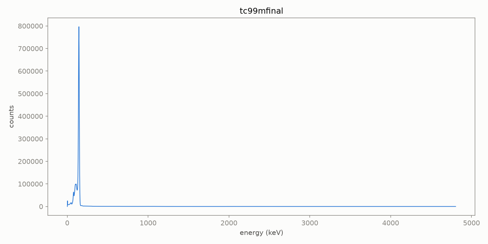
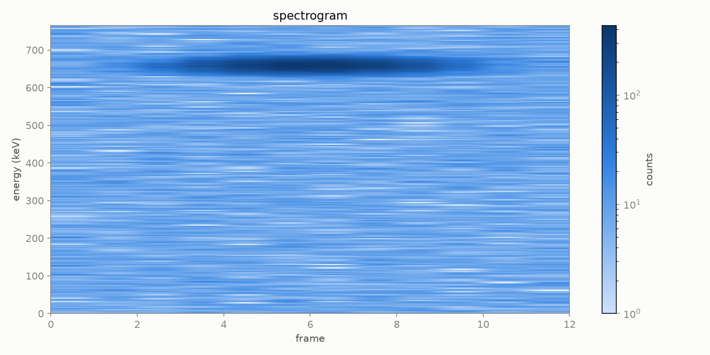
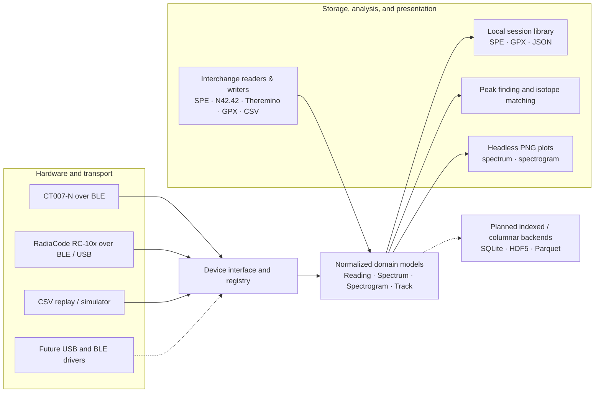

# openrad

[](https://github.com/nulvox/openrad/actions/workflows/ci.yml)
[](https://www.python.org/)
[](LICENSE)

**openrad is a modular Python framework and CLI for radiation-detector hardware, gamma-spectrum analysis, and geotagged time-series telemetry.** It turns vendor-specific or replayed measurements into a small, typed domain model, then routes them to open file formats, a local session library, analysis tools, and headless plots.

The project currently supports hardware-free CSV replay, live Bluetooth LE streaming from the GammaGuard CT007-N, and BLE/USB telemetry plus spectrum acquisition for RadiaCode RC-10x detectors, along with `.spe`/Theremino spectrum import, GPX export, spectrograms, and reference-library peak matching. It is an early `0.1.x` project—not a calibrated radiation-safety instrument or a substitute for professional analysis.

## See it work

```console
$ uv run openrad devices
- ct007n
- radiacode
- replay

$ uv run openrad replay examples/sample_session.csv --speed 0 --plain --no-save
openrad live — CSV Replay
09:00:00  cps=  4.80  dose=  0.110 uSv/h  lat=52.52000  lon=13.40450
09:00:02  cps=  5.10  dose=  0.120 uSv/h  lat=52.52005  lon=13.40455
09:00:08  cps=  9.70  dose=  0.230 uSv/h  lat=52.52020  lon=13.40470
09:00:10  cps= 14.20  dose=  0.340 uSv/h  lat=52.52025  lon=13.40475
09:00:18  cps=  4.90  dose=  0.110 uSv/h  lat=52.52045  lon=13.40495

$ uv run openrad spectrum tests/fixtures/theremino/tc99mfinal.txt \
    --out docs/assets/sample-spectrum.png
Wrote docs/assets/sample-spectrum.png

$ uv run openrad spectrogram examples/spectrogram \
    --out docs/assets/sample-spectrogram.png
Wrote docs/assets/sample-spectrogram.png
```

<table>
  <tr>
    <td width="50%"></td>
    <td width="50%"></td>
  </tr>
  <tr>
    <td align="center"><em>Theremino MCA spectrum fixture</em></td>
    <td align="center"><em>Time-resolved example spectrogram</em></td>
  </tr>
</table>

## Architecture



Drivers depend on the shared model—not the CLI or storage layer—so adding detector support is isolated to an implementation of `openrad.devices.base.Device`. See [the architecture guide](docs/ARCHITECTURE.md) for the interface and extension points.

## Engineering highlights

- **Strictly typed Python:** `mypy --strict`, Ruff, and pytest run against every change. Core APIs use dataclasses and typed driver/storage boundaries rather than device-specific dictionaries.
- **Normalized scientific data:** drivers convert transport-specific payloads into readings, spectra, spectrogram frames, and tracks with explicit units (`cps`, `µSv/h`, `keV`, seconds, latitude/longitude) and energy calibration. Measurement-uncertainty propagation is not implemented yet and is called out in the [roadmap](docs/ROADMAP.md) rather than implied.
- **Pluggable hardware backends:** a synchronous `Device` contract supports synthetic replay and real hardware. The CT007-N driver bridges Bleak's async BLE notifications to the common iterator API through a background event loop and thread-safe queue.
- **Safety-conscious hardware handling:** the CT007-N's undocumented count protocol was reverse engineered from a physical unit. openrad refuses to invent a counts-to-dose conversion; dose remains unset (`0.0`) unless the user supplies a device-specific factor.
- **Open interoperability:** ORTEC/IAEA `.spe`, ANSI N42.42 XML (for InterSpec and institutional tools), Theremino MCA imports, GPX 1.1 read/write with radiological extensions, and plain JSON metadata keep sessions inspectable without a proprietary database.
- **Portable CI:** GitHub Actions exercises Python 3.10–3.12 on Linux, macOS, and Windows; visualization tests use Matplotlib's headless Agg backend.

## Current capabilities

| Area | Implemented now | Important limits |
| --- | --- | --- |
| Devices | CSV replay; GammaGuard CT007-N live BLE count stream; RadiaCode RC-10x BLE/USB telemetry + spectrum driver | RadiaCode driver is tested against protocol fixtures while awaiting hardware-in-the-loop verification; CT007-N dose conversion requires a user-supplied factor; no GQ GMC driver yet |
| Telemetry | Rich live dashboard or plain stream; optional GPS track capture | No live map renderer |
| Spectroscopy | `.spe` and ANSI N42.42 `.n42` read/write; Theremino MCA import; RadiaCode `read_spectrum()`; static spectrum and spectrogram PNGs | Live spectrogram frame accumulation is not implemented yet |
| Analysis | Local-maxima peak finding and matching against fetched SandiaDecay gamma lines | Exploratory candidate matching, not lab-grade isotope identification |
| Storage | Per-session local library with GPX, SPE, and JSON metadata (save + load round-trip); ANSI N42.42 export (`openrad export-n42`) | No database/index, HDF5, or Parquet export yet |

## Quickstart

Requires [uv](https://docs.astral.sh/uv/):

```bash
uv sync --extra dev
uv run openrad devices
uv run openrad replay examples/sample_session.csv --speed 0
```

Each saved replay session is written under `~/.openrad/library/<session_id>/`. Use `--no-save` to skip it or `--library-dir PATH` to choose another location.

Visualization dependencies are optional for library users:

```bash
uv sync --extra viz
uv run openrad spectrum tests/fixtures/theremino/tc99mfinal.txt --out spectrum.png
uv run openrad spectrogram examples/spectrogram --out spectrogram.png
```

On NixOS, run commands inside the included development shell so binary Python wheels can find their runtime libraries:

```bash
nix develop
uv sync --extra dev
```

### Isotope candidate matching

The nuclear reference database is not vendored because it is roughly 6 MB and separately licensed. Fetch it once, then run `identify`:

```bash
uv run python scripts/fetch_isotope_database.py
uv run openrad identify tests/fixtures/theremino/tc99mfinal.txt
```

Identification uses local-maxima peak detection plus energy matching against known gamma lines, including short-lived daughters folded into their parent under a secular-equilibrium assumption. Treat the output as leads for investigation, not conclusions.

### Live CT007-N and RadiaCode telemetry

Install the BLE extra (or `usb` for USB connections), then connect by BLE address or advertised-name substring:

```bash
uv sync --extra ble
uv run openrad ct007n "CT-N-13" --plain
uv run openrad radiacode --bluetooth "RadiaCode" --plain
uv run openrad radiacode --bluetooth "RadiaCode" --spectrum-out snapshot.spe
```

The CT007-N does not expose a trustworthy counts-to-dose factor over the discovered characteristics. Pass `--counts-per-usv VALUE` only when you know the calibration for your unit.

The RadiaCode driver implements the wire protocol reverse-engineered by Maxim Andreev ([@cdump](https://github.com/cdump)) and contributors in [`cdump/radiacode`](https://github.com/cdump/radiacode). It is currently validated against synthetic protocol fixtures while we wait on a physical unit—**live testers with a RadiaCode 101/102/103/103G over BLE or USB are very welcome** (please open an issue with your firmware version and results!).

## Development

```bash
uv sync --extra dev
uv run ruff check .
uv run mypy
uv run pytest
```

```text
src/openrad/
  core/      Shared domain models and calibration
  devices/   Device interface, registry, replay, CT007-N BLE, and RadiaCode BLE/USB drivers
  storage/   SPE, GPX, Theremino, spectrogram loading, and local library
  analysis/  Peak finding and isotope reference matching
  viz/       Headless spectrum and spectrogram rendering
  cli/       Typer command-line entrypoint
```

For completed and planned work, see [docs/ROADMAP.md](docs/ROADMAP.md).

## Contributing & Call for Hardware Testers

- **Live hardware testing needed:** If you own a **RadiaCode 101/102/103/103G** or **GammaGuard CT007-N**, testing `openrad radiacode` / `openrad ct007n` against real hardware and reporting how it behaves (BLE vs. USB, firmware version, spectrum export) is hugely helpful.
- **New hardware drivers:** Adding another detector is the highest-value code contribution. Start with [`Device`](src/openrad/devices/base.py), the [architecture guide](docs/ARCHITECTURE.md#adding-a-new-driver), and the replay driver as a reference implementation. Issues and pull requests are welcome.

## Acknowledgments

- RadiaCode BLE/USB protocol support is built on the reverse-engineering work of Maxim Andreev ([@cdump](https://github.com/cdump)) and the [`cdump/radiacode`](https://github.com/cdump/radiacode) project.
- Nuclear decay and gamma-line reference data is sourced from Sandia National Laboratories' [`SandiaDecay`](https://github.com/sandialabs/SandiaDecay) database.

## License

MIT — see [LICENSE](LICENSE).
